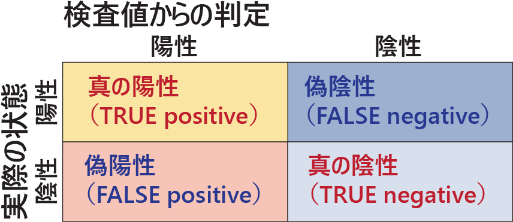

# ROC（受信者動作特性） {.unnumbered}

```{r, echo = FALSE, message=FALSE}
library(tidyverse)
library(patchwork)
```

**ROC（Receiver Operating Characteritic、受信者動作特性）**とは、連続値の検査結果から陽性・陰性の判定を行う場合の閾値を決めるための手法のことです。

## 検査の判定と閾値

例えばコロナウイルスの診断では、qPCR（Quarntitative Polymerase Chain Reaction）という手法を使ってコロナウイルスの陽性・陰性を判定します。qPCRでは結果としてC~t~という値が出てきます。陽性の方ではC~t~が小さく、陰性の方ではC~t~が大きくなります。C~t~がある値より小さい場合にはコロナウイルス陽性、大きい場合には陰性と判定します。この「ある値」のことを**閾値**と呼びます。

閾値を小さくすると、陽性の人を確実に陽性と判定することができますが、陽性でもC~t~が高い人がいると見逃して陰性と判定してしまいます。

逆に閾値を大きくすると、陽性の人を見逃さず判定することができますが、陰性でC~t~が低い人を陽性と誤って判定してしまいます。

ですので、陽性の人をできるだけ正しく陽性と判定し、陰性の人をできるだけ正しく陰性と判断するためには、適切な閾値を設定する必要があります。

コロナウイルス陽性の人を陽性と判定することを「真の陽性（TRUE Positive）」、コロナウイルス陰性の人を正しく陰性と判定することを「真の陰性（TRUE Negative）」と呼びます。また、陽性の人を誤って陰性と判定することを「偽陰性（FALSE Negative）」、陰性の人を誤って陽性と判定することを「偽陽性（FALSE Positive）」と呼びます。検査を受けた人には陽性・陰性の判定と、真にコロナウイルスに感染している・感染していないという状態があるはずですので、陽性・陰性・偽陽性・偽陰性の4つの割合を足すと全員分、つまり割合が1になります。

{width=500}

qPCRでうまくコロナウイルスの陽性・陰性を判定するには、偽陽性・偽陰性の割合を小さくすればよいはずです。

:::{.callout-tip collapse = "true"}
## 検査値と陽性・陰性の関係

PCRはDNAを増幅する手法のことで、PCRは1サイクルにつきDNAを2倍に増加させます。C~t~はDNAの増幅を評価する値で、DNAの量が最大の半分になるときのサイクル数を反映するものです。実際にはあるサイクルで最大の半分になるわけではないので、ロジスティック回帰（[30章](chapter30.qmd#目的変数が二項分布の場合)で説明）で回帰して変曲点としてC~t~を求めます。ですので、C~t~は整数値ではなく、連続値として求まります。

元々の検体（サンプル）に増幅対象となるDNAがたくさん含まれていると、DNAは速く増幅されます。ですので、サイクル数(C~t~）は小さくなります。逆にサンプルに増幅対象となるDNAが含まれない場合にはDNAはゆっくり増幅されるか、増幅されないため、C~t~は大きくなります。コロナウイルスの検出では、増幅の対象となるDNAがコロナウイルスのRNAに含まれる配列ですので、コロナウイルスに感染した方の検体にはコロナウイルス由来のDNAが多く含まれ、C~t~が小さくなります。

このようにコロナウイルスの検出では値（C~t~）が低い場合に陽性になりますが、値が大きい場合に陽性となる場合もあります。典型的な例は糖尿病で、血中のグルコース濃度が高いと糖尿病（陽性）、そうでなければ健康（陰性）となります。どちらの場合でもROCを用いることで良い閾値を求めることができます。
:::

## 閾値と偽陽性・偽陰性の関係

では、具体的に検査値と判定の関係を見ていきます。まずは陽性の人のC~t~値と陰性の人のC~t~値をポアソン分布の乱数として作成します。ポアソン分布の`lambda`（平均値と分散）は陽性で25、陰性で40とします。陽性の人と陰性の人のC~t~値の分布は以下のグラフの通りです。

```{r, filename="陽性と陰性の人のCtを作成する", message=FALSE}
set.seed(0)
# Ct値は連続数を取れるが、簡便に表現するため整数値とする
positive_Ct <- rpois(100, 25)
negative_Ct <- rpois(100, 40)

d <- data.frame(
  outcome = rep(c("positive", "negative"), c(100, 100)),
  Ct = c(positive_Ct, negative_Ct)
)

d |> 
  ggplot(aes(x = Ct, fill = outcome)) +
  geom_histogram(position = "dodge")

```
仮に閾値をC~t~=30としましょう。C~t~が30以下の人は陽性、C~t~が30より大きい人は陰性とします。200人の判定のうち、真の陽性は87例、真の陰性は89例、偽陽性は11例、偽陰性は13例となっています。ですので、閾値が30の時、陽性/（陽性＋偽陰性）の割合は87%、陰性/（陰性＋偽陽性）の割合は89%となります。

この陽性/（陽性＋偽陰性）の割合のことを**感度**、陰性/（陰性＋偽陽性）の割合のことを**特異度**と呼びます。感度と特異度の両方を高くすることができる閾値がより良い閾値です。

```{r, filename="Ct=30のときの陽性・陰性の割合"}
# 閾値が30のときの判定を計算
d$threshold_30 <- if_else(d$Ct <= 30, "posi", "nega")

# case_whenで評価（case_whenについては20章を参照）
case_when(
  d$threshold_30 == "nega" & d$outcome == "negative" ~ "TRUE negative",
  d$threshold_30 == "nega" & d$outcome == "positive" ~ "FALSE negative",
  d$threshold_30 == "posi" & d$outcome == "positive" ~ "TRUE Positive",
  d$threshold_30 == "posi" & d$outcome == "negative" ~ "FALSE Positive"
) |> factor() |> table()
```

ではC~t~=35を閾値とするとどうなるでしょうか。C~t~=35が閾値の時、感度は99%と高くなりましたが、特異度は74%まで低下しました。感度は改善したけど特異度は悪くなったため、C~t~=30とC~t~=35のどちらが優れた閾値であるかをこの結果だけから比較するのは難しいです。

```{r, filename="Ct=35のときの陽性・陰性の割合"}
d$threshold_35 <- if_else(d$Ct <= 35, "posi", "nega")
case_when(
  d$threshold_35 == "nega" & d$outcome == "negative" ~ "TRUE negative",
  d$threshold_35 == "nega" & d$outcome == "positive" ~ "FALSE negative",
  d$threshold_35 == "posi" & d$outcome == "positive" ~ "TRUE Positive",
  d$threshold_35 == "posi" & d$outcome == "negative" ~ "FALSE Positive"
) |> factor() |> table()
```

この結果をグラフで表示すると以下のようになります。閾値が大きくなると感度が上がって特異度が下がっています。逆に閾値が小さくなると感度が下がって特異度が上がります。ですので、感度と特異度には片方が大きくなるともう片方が小さくなる関係があり、同時に大きくすることはできません。

```{r, filename="閾値の変化と偽陽性・偽陰性の割合", message=FALSE, warning=FALSE}
p1 <- 
  d |> 
    ggplot(aes(x=Ct, fill = threshold_30)) +
    geom_histogram()+
    ylim(0, 20) +
    xlim(14, 55)+
    labs(x = "Ct", y = "頻度", title = "閾値=30の場合")+
    theme(legend.position = "bottom")+
    facet_grid(outcome ~ .)

p2 <- 
  d |> 
    ggplot(aes(x=Ct, fill = threshold_35)) +
    geom_histogram()+
    ylim(0, 20) +
    xlim(14, 55)+
    labs(x = "Ct", y = "頻度", title = "閾値=35の場合", caption = "上の赤い部分が特異度、下の青い部分が感度")+
    theme(legend.position = "bottom")+
    facet_grid(outcome ~ .)

p1 + p2
```


このような状況で、最適な閾値を求める方法がROCです。ROCでは、ROC曲線というものを作成して評価します。

## ROC曲線

**ROC曲線**は、様々な閾値を設定した場合の特異度を横軸、感度を縦軸に取った曲線のことです。上の例ではC~t~は30と35だけを評価しましたが、ROC曲線を作成する場合、この閾値をC~t~の最小値から最大値まで振って、それぞれの感度と特異度を計算します。

```{r, filename="ROC曲線を作成する準備"}
estimate_out <- function(threshold){
  est <- if_else(d$Ct <= threshold, "posi", "nega") # ある閾値での判定
  TP <- sum(est == "posi" & d$outcome == "positive") # 感度（TRUE positive）の数を計算
  TF <- sum(est == "nega" & d$outcome == "negative") # 特異度（TRUE negative）の数を計算
  c(threshold, TP/100, TF/100)
}

# Ctの最小値から最大値までのベクターを準備
thre <- seq(d$Ct |> min(), d$Ct |> max(), by = 1)

# mapplyで感度・特異度を計算
d_est <- mapply(estimate_out, thre) |> t() |> data.frame()
colnames(d_est) <- c("threshold", "TRUE_positive", "TRUE_negative")

knitr::kable(head(d_est))
```

ただし、普通に感度と特異度をグラフにしてしまうと、ROCとして知られているグラフとはx軸が左右逆になります。

```{r, filename="感度と特異度をプロットする", fig.width = 6, fig.height = 6}
plot(d_est$TRUE_negative, d_est$TRUE_positive,type = "l", xlab = "特異度", ylab = "感度")
```

このx軸、感度を逆にするとROC曲線と呼ばれるものになります。ただし、正しいROCでは線は斜めに繋がず、[`geom_step`](chapter26.qmd#geom_step)で示されるような階段状のグラフとして表示します。

```{r, filename="ROC曲線:x軸を逆転させる", fig.width = 6, fig.height = 6}
plot(d_est$TRUE_negative, d_est$TRUE_positive,type = "l", xlab = "特異度", ylab = "感度", xlim = c(1, 0))
```

### AUC（Area Under the Curve）

ROCを使えば閾値をうまく定めることができますが、そもそも測定した評価値の質が良くなければ、きちんと陽性・陰性を判定できません。コロナウイルスの検出の例で言うと、PCRの他に抗原検査というものがあります。PCRと抗原検査で結果が必ず一致する訳ではないので、どちらのほうが検査値として質が良いか、うまく比較する必要があります。

この検査値の質を評価する指標が、ROC曲線の**AUC（Area Under the Curve、曲線下面積）**と呼ばれるものです。AUCはROC曲線の下側の面積のことで、この面積が大きい（1に近い）ほど、その検査値はうまく陽性・陰性を判別することができます。AUCは[台形法（Trapezoidal rule）](https://en.wikipedia.org/wiki/Trapezoidal_rule)で計算するのが一般的ですが、台形法だと階段状のROC曲線としてのAUCの計算結果とはずれが生じます。

AUCが大きい指標を用いることで、より精度の高い判定を得ることができます。

```{r, filename="ROC曲線のAUCを計算する"}
# 感度の差分を取る
dif_TP <- d_est$TRUE_positive |> diff()

# 台形法で計算するため、特異度を1つずらして和を取ったベクターを計算
TN_tz <- d_est$TRUE_negative[-1] + head(d_est$TRUE_negative, -1)

# 台形法でAUCを演算
sum(TN_tz * dif_TP / 2)

# 台形法を用いないのであれば、もっとシンプルにAUCを計算できる
sum(d_est$TRUE_negative[-1] * dif_TP)
```

### 閾値を決定する

最適な閾値は、Youden Indexというものを用いて決定します。Youden Indexは、感度と特異度を足して1を引いた指標です。最適な閾値では、このYouden Indexが最大になります。ですので、上記のROC曲線ではYouden Indexを最大にする閾値は32となり、閾値を32にすることでうまく陽性・陰性を判定することができます。

```{r, filename = "Youden indexを最大化する閾値を求める"}
d_est$YI <- d_est$TRUE_positive + d_est$TRUE_negative - 1 # Youden Indexを求める
threshold_YI <- d_est |> filter(YI == max(YI)) # Youden Indexを最大にする点
threshold_YI
```

このYouden Indexを最大にする閾値における感度と特異度をグラフに示すと、以下の点のようになります。この点は、傾き1の線でROC曲線の接線を作成した時の接点となります。

```{r, fig.width = 6, fig.height = 6, filename="Youden Indexを最大にする点"}
ggplot() +
  geom_path(data = d_est, mapping = aes(x = TRUE_negative, y = TRUE_positive)) +
  geom_abline(slope = 1, intercept = 0.95 + 0.86, color = "#F8766D", linewidth = 2)+
  geom_point(data = threshold_YI, mapping = aes(x = TRUE_negative, y = TRUE_positive), size = 5, color = "#00BFC4")+
  scale_x_reverse()
```

## pROCパッケージ

ココまではRのデフォルトの機能を用いてROCを計算していましたが、RにはROCの計算を行うためのパッケージがたくさんあります。ココでは、代表的なパッケージとして、`pROC`[@pROC_bib]を紹介します。使い方にちょっと癖があり、やや取り扱いが難しいですが、機能が豊富なパッケージです。

```{r, filename="パッケージのインストール・読み込み"}
pacman::p_load(pROC)
```

### pROC: ROC曲線を描画する

pROCでROC曲線を描画するときには、`plot.roc`関数を用います。`plot.roc`関数はformulaを引数に取り、左辺に真の判定、右辺に検査値を指定します。また、単に判定と検査値を引数に取ってもROC曲線を描くことができます。

```{r, filename="pROC: plot.roc関数", fig.width = 6, fig.height = 6}
plot.roc(d$outcome ~ d$Ct) # plot.roc(d$outcome, d$Ct)でもよい
```

また、`roc`関数を用いて演算を行い、この`roc`関数の返り値を`plot`関数に渡すことでもROC曲線を描画することができます。

```{r, filename="pROC: roc関数を用いてROC曲線を描画する", fig.width = 6, fig.height = 6}
out_roc <- roc(d$outcome, d$Ct)
plot(out_roc)
```

単に`roc`関数の返り値を呼ぶと、AUCが表示されます。また、`ci.auc`関数に`roc`関数の返り値を渡すとAUCの95%信頼区間が表示されます。`var`関数ではAUCの分散が、`roc`関数の引数に`partial.auc`を指定すると部分AUC（partial AUC）を計算することができます。

また、`ci.coords`や`ci.se`関数を用いると、ROC曲線の信頼区間を求めることもできます。

```{r, filename="rocオブジェクトとAUC、信頼区間の計算"}
class(out_roc) # rocクラスのオブジェクト
out_roc # AUCの表示
out_roc |> ci.auc() # AUCの信頼区間の表示
out_roc |> var() # AUCの分散
d |> roc("outcome", "Ct", partial.auc = c(1, 0.9)) # partial AUCの演算

out_roc |> ci.coords(x = 0.95, input = "sensitivity") # 感度が0.95のときの信頼区間
out_roc |> ci.se() # 広範な感度に対する特異度の信頼区間
```

### pROC: ROC曲線への信頼区間・スムージング・最適な閾値の表示

`pROC`では信頼区間の演算を行わなくてもROC曲線に信頼区間を付け加えることができます。ただし、記法はやや特殊で、まず`ci=TRUE`を指定した`plot.roc`関数の返り値を準備します。このオブジェクトを`ci.se`関数の引数に取り、さらに返り値を`plot`関数の引数に取ることで信頼区間を含むROC曲線を描くことができます。

```{r, fig.width = 6, fig.height = 6, filename="ROC曲線に信頼区間を追加する"}
rocobj <- plot.roc(d$outcome, d$Ct, ci = TRUE)

# 信頼区間を計算する特異度の間隔はspecificities引数に指定
ciobj <- ci.se(rocobj, specificities = seq(0, 1, 0.05)) 

plot(ciobj, type = "shape", col = "#00BFC4")
```

ROC曲線のスムージングを行うには、まず`plot.roc`関数を実行し、返り値をオブジェクトとした上で、その返り値を`smooth`関数の引数にとり、さらに`lines`関数内で呼び出します。`plot.roc`と`lines`関数は連続して呼び出す必要があります。

```{r, fig.width = 6, fig.height = 6, filename="スムージング"}
rocobj <- plot.roc(d$outcome, d$Ct)
lines(smooth(rocobj), col = "#00BFC4")
```

また、最適な閾値は`plot.roc`関数に`of`引数、`thresholds`引数、`print.thres`引数を以下のように指定することで表示させることができます。いずれもやや癖が強くて覚えにくいですが、自分でたくさんの演算を記述することなく演算を行うことができます。

```{r, fig.width = 6, fig.height = 6, filename="最適な閾値における信頼区間の表示"}
plot.roc(d$outcome, d$Ct, ci=TRUE, of="thresholds", thresholds="best", print.thres="best")
```

ROC曲線については以下のshinyliveのアプリも参考にしてください。

[ROCシミュレータ](https://roc-shinylive.pages.dev/)

### pROC: 検査値の質を比較する

上記の通り、ROC曲線ではAUCが高いほど、うまく陽性・陰性を判定することができます。検査値ごとにAUCを評価すれば、どの検査値が最も判定の精度が高いか評価することもできます。このAUCの比較を行い、AUCの統計的な有意差を検定するための関数が`roc.test`関数です。`roc.test`関数では、複数の検査値を引数に与えることで、検査値間のAUCを比較します。

以下の例ではqPCR（C~t~）と抗原検査（antigen test）でのコロナウイルス検査の判定に関わる`roc.test`を行っています。この2つの検査では、qPCRでのAUCが0.9730、抗原検査でのAUCが0.8846でとなり、pは0.001以下で有意な結果を得ています。

データ数が100以上あれば検定を行う必要はあまりないかもしれませんが、データが少ない時に差を評価するためには有用でしょう。また、デフォルトでは`roc.test`関数はブートストラップによるp値の計算を行いますが、この他にDelong、Venkatramanなどの手法を`method`引数に指定することで、他の手法での検定を行うこともできます。

```{r, filename="roc.test関数でAUCの差を検定する"}
positive_antigen <- rlnorm(100, 10, 5) # 陽性は対数正規分布のmeanlogが10
negative_antigen <- rlnorm(100, 2, 5) # 陰性は対数正規分布のmeanlogが2
d$antigen <- c(positive_antigen, negative_antigen)

roc.test(d$outcome, d$Ct, d$antigen)
```

グラフでROC曲線を表示すると以下のようになります。赤がC~t~、青が抗原検査です。qPCRの方がよりAUCが高いことがわかります。

```{r, fig.width = 6, fig.height = 6, filename="最適な閾値における信頼区間の表示"}
plot.roc(d$outcome, d$Ct, col = "#F8766D")
lines.roc(d$outcome, d$antigen, col = "#00BFC4")
```

## pROC: ggplot2のグラフを描画する

ROC曲線を`ggplot2`のグラフとして描画する場合には、`ggroc`関数を用います。`ggroc`関数は`roc`関数の返り値を引数に取ります。`ggplot2`の関数（`scale`関係の関数や`labs`など）を`+`で繋ぐことで、`ggplot2`と同様にグラフのレイアウトを変更することができます。

```{r, fig.width = 6, fig.height = 6, filename="ggplot2のグラフを描画する"}
roc(d$outcome, d$Ct) |> ggroc()
```


